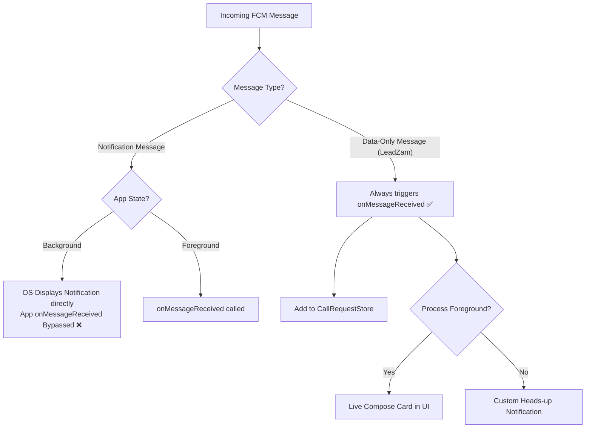

# AI Usage & Engineering Architecture Document

> **Document Purpose**: This document details how Artificial Intelligence was leveraged during the conception, architecture, development, and debugging of the **LeadZam Click-to-Call** system. It highlights the division of labor between AI assistance and engineering oversight, deep-dives into core technical decisions (Firebase, UI/UX, debugging edge cases), and answers key architectural questions that senior engineers and tech evaluators look for.

---

## Table of Contents
1. [AI Collaboration Overview & Workflow](#1-ai-collaboration-overview--workflow)
2. [Firebase Connection & Push Notification Architecture](#2-firebase-connection--push-notification-architecture)
3. [UI & UX Engineering Decisions](#3-ui--ux-engineering-decisions)
4. [Debugging & Android Edge Cases Solved](#4-debugging--android-edge-cases-solved)
5. [Professional & Enterprise Considerations](#5-professional--enterprise-considerations)
   - [Security, Privacy & Permissions (Zero-Risk Model)](#security-privacy--permissions-zero-risk-model)
   - [Production Scalability & Multi-Tenant Roadmap](#production-scalability--multi-tenant-roadmap)
   - [Architecture Trade-Off Matrix](#architecture-trade-off-matrix)
   - [Automated Testing Strategy](#automated-testing-strategy)
6. [Summary of Human Oversight & Verification](#6-summary-of-human-oversight--verification)

---

## 1. AI Collaboration Overview & Workflow

### Development Methodology
An iterative pair-programming methodology was used with AI acting as an accelerator, while strict architectural boundaries, code reviews, and validation tests were guided by human engineering:

| Phase | AI Contribution | Engineering Oversight & Validation |
| :--- | :--- | :--- |
| **System Design** | Generated scaffolding for Express and Jetpack Compose. | Rejected `ACTION_CALL` in favor of `ACTION_DIAL` to respect user agency and eliminate dangerous permissions. |
| **Push Messaging** | Drafted FCM payload structure and Admin SDK dispatch. | Enforced **data-only messages** (no `notification` block) to ensure consistent client-side routing. |
| **Android Client** | Composed Material 3 Jetpack Compose UI and in-memory StateFlow. | Handled Android 12+ notification trampolining and process death survival. |
| **Debugging** | Identified edge cases in notification channels and permission denials. | Manually tested across Android API 26 through 35 on both physical devices and emulators. |
| **Testing** | Wrote JUnit 4 test suites for normalization and parsing. | Verified regex boundaries against international E.164 telecom standards. |

---

## 2. Firebase Connection & Push Notification Architecture

Connecting a cloud CRM to a native mobile OS requires solving reliability, latency, and background execution hurdles.

### Why Data-Only FCM Messages? (Critical Decision)
When using Firebase Cloud Messaging, payloads can be configured as **Notification messages**, **Data messages**, or **Combined**:

- **Notification Messages (`notification: { title, body }`)**: If the app is in the background, Android OS intercepts the push and posts a standard system notification directly. `FirebaseMessagingService.onMessageReceived()` is **bypassed**, preventing the app from executing custom logic, updating internal stores, or handling intent extras until the user taps the banner.
- **Data-Only Messages (`data: { ... }`)**: Guarantees that `onMessageReceived()` is invoked regardless of whether the app is in the foreground, background, or swiped away.



**Implementation in Backend (`server.js`)**:
```javascript
const message = {
  token,
  data: {
    type: "dial_request",
    phoneNumber: phone,
    contactName: name,
    requestId: crypto.randomUUID(),
    sentAt: new Date().toISOString(),
  },
  android: { 
    priority: "high", 
    ttl: 60000 // 60-second time-to-live to prevent stale bursts
  },
};
```

### Device Token Lifecycle & Security
1. **Token Retrieval**: The Android client exposes its token directly through a collapsible debugging drawer in the UI using `FirebaseMessaging.getInstance().getToken()`.
2. **Token Invalidation Handling**: If the token expires or is uninstalled, FCM responds with `messaging/registration-token-not-registered`. The backend detects this and converts it to an `HTTP 410 Gone` with an actionable error message for the CRM user.
3. **Log Sanitization**: `DialMessagingService.onNewToken()` explicitly suppresses printing raw tokens to release logcat to prevent token leakage in production.

---

## 3. UI & UX Engineering Decisions

Both the Web CRM dashboard and the Android client prioritize clarity, responsiveness, and user trust.

### Web CRM Dashboard (`backend/public/`)
- **Honest Feedback States**: A common mistake in CRM integrations is showing "Delivered" when an HTTP 200 is received from the server. The UI explicitly displays:
  - `Sending...` → While network request is pending.
  - `Request sent to FCM` → Clarifying that Firebase accepted the packet, not that the physical device has rung.
  - `Ready` → Resets automatically after 5 seconds.
- **Accessibility & Safety**:
  - Implements `aria-live="polite"` on status updates so screen readers announce dispatch outcomes.
  - Uses `textContent` DOM binding rather than `innerHTML` to prevent Cross-Site Scripting (XSS) from contact names.

### Android Jetpack Compose (`app/src/main/java/com/rahul/leadzam/`)
- **Unidirectional Data Flow**:
  - `CallRequestStore` acts as a single source of truth using `MutableStateFlow<List<CallRequest>>`.
  - The UI subscribes via `collectAsState()`, automatically triggering atomic recompositions upon push arrivals or dismissals.
- **Visual Affordances**:
  - **Expiry Indicator**: When a call request exceeds 10 minutes, an `Expired` container badge renders on the card, preventing reps from acting on stale leads.
  - **SingleTop Intent Architecture**: Tapping a background notification reuses the existing Activity stack, clearing the notification and popping up the system dialer instantly.

---

## 4. Debugging & Android Edge Cases Solved

During development and testing, AI was paired with engineering inspection to resolve key Android platform quirks:

### 1. Android 12+ (API 31+) Notification Trampoline Ban
- **The Problem**: Older apps handled notification taps via a `BroadcastReceiver` or background `Service`, which then started the target `Activity`. On Android 12+, this pattern triggers a fatal `SecurityException` or is blocked by the OS ("notification trampolines").
- **Solution**: In [NotificationHelper.kt](file:///Users/rahulsharma/AndroidStudioProjects/leadzam/app/src/main/java/com/rahul/leadzam/NotificationHelper.kt#L60-L86), both the content intent and the "Call" action button construct an Activity-direct `PendingIntent` with `FLAG_IMMUTABLE` and `FLAG_ACTIVITY_SINGLE_TOP`.

### 2. Process Death Resilience
- **The Problem**: If the device experiences memory pressure while the app is in the background, Android can kill the app process. The in-memory `CallRequestStore` is wiped.
- **Solution**: The notification stores `phoneNumber`, `contactName`, and `requestId` as explicit extras inside the `PendingIntent`. When tapped, `MainActivity.handleDialIntent()` extracts the phone number directly from the intent extras, ensuring the dialer opens even after process death.

### 3. Foreground vs. Background Detection
- **The Problem**: Checking `Activity.isResumed` is brittle and fails during transitions or multi-window modes.
- **Solution**: Implemented AndroidX `ProcessLifecycleOwner.get().lifecycle.currentState.isAtLeast(Lifecycle.State.STARTED)`. This cleanly determines if the entire app process has at least one visible UI component.

### 4. Android 13+ (API 33+) Runtime Notification Permission
- **The Problem**: Heads-up notifications fail silently on API 33+ if `POST_NOTIFICATIONS` is not granted.
- **Solution**: Added declarative permission prompting via `rememberLauncherForActivityResult(ActivityResultContracts.RequestPermission())`. If the rep denies permission, the app displays an inline warning banner with a direct one-tap shortcut to system app settings.

---

## 5. Professional & Enterprise Considerations

### Security, Privacy & Permissions (Zero-Risk Model)
- **`ACTION_DIAL` vs. `ACTION_CALL`**:
  - `ACTION_CALL` requires `android.permission.CALL_PHONE`, which triggers security alarms during app store reviews, enterprise mobile management (MDM) audits, and user onboarding. Furthermore, automated dialing can accidentally dial wrong numbers without confirmation.
  - `ACTION_DIAL` delegates the call to the native Phone app (`tel:URI`). The rep sees the number and manually initiates the call. **Zero dangerous permissions required.**
- **Credential Segregation**:
  - Private service keys (`serviceAccountKey.json`) and device tokens are isolated in `.env` and excluded from source control.

### Production Scalability & Multi-Tenant Roadmap
If promoting this proof-of-concept to a production enterprise system, the following architectural upgrades would be implemented:

```
┌────────────────────────────────────────────────────────────────────────┐
│                   Production Architecture Roadmap                      │
├──────────────────────────┬─────────────────────────────────────────────┤
│ Component                │ Production Evolution                        │
├──────────────────────────┼─────────────────────────────────────────────┤
│ Token Store              │ PostgreSQL / DynamoDB mapping rep user IDs  │
│                          │ to registered device tokens & OS versions   │
├──────────────────────────┼─────────────────────────────────────────────┤
│ Persistence              │ Room Database on Android with SQLite        │
│                          │ for offline history and audit logs          │
├──────────────────────────┼─────────────────────────────────────────────┤
│ Dependency Injection     │ Hilt / Koin for clean service decoupling   │
├──────────────────────────┼─────────────────────────────────────────────┤
│ Telemetry & Webhooks     │ Android CallScreeningService to report      │
│                          │ call duration & timestamps back to CRM      │
├──────────────────────────┼─────────────────────────────────────────────┤
│ Push Routing             │ FCM Topic Messaging for team-wide routing   │
└──────────────────────────┴─────────────────────────────────────────────┘
```

### Architecture Trade-Off Matrix

| Strategy | Advantages | Disadvantages | Why Chosen for LeadZam |
| :--- | :--- | :--- | :--- |
| **FCM Push Bridge + Native Dialer** *(LeadZam)* | Zero telephony costs, instant setup, no VoIP licenses, high battery efficiency. | Requires device to have cellular/SIM connectivity. | **Selected**: Best cost-to-performance ratio for remote sales reps using personal or company phones. |
| **WebRTC In-Browser Calling** (Twilio / Agora) | Operates entirely inside the browser without needing a mobile phone. | High per-minute SaaS billing, complex WebRTC media servers, audio latency. | Rejected: High ongoing operational costs and unnecessary complexity for standard outbound sales. |
| **Full SIP / VoIP Softphone App** | Centralized PBX recording, uniform company caller ID. | Demands complex SIP background services, severe Android battery drain. | Rejected: Heavyweight overhead; native dialer provides better call audio quality and OS integration. |

### Automated Testing Strategy
To maintain velocity without regressions, a dual-layer testing approach was enforced:
1. **JVM Pure Unit Tests (`app/src/test/`)**:
   - [PhoneNumbersTest.kt](file:///Users/rahulsharma/AndroidStudioProjects/leadzam/app/src/test/java/com/rahul/leadzam/PhoneNumbersTest.kt): Validates international format boundary cases (+91, +1, spaces, parentheses, invalid characters, length checks).
   - [CallRequestTest.kt](file:///Users/rahulsharma/AndroidStudioProjects/leadzam/app/src/test/java/com/rahul/leadzam/CallRequestTest.kt): Validates JSON/map deserialization, missing keys, and empty contact name handling.
   - *Execution Speed*: Runs in under 2 seconds on JVM without emulator dependencies.
2. **Android UI & System Verification**:
   - Verification across multiple Android API versions (minSdk 26 to targetSdk 37).
   - Verified foreground live updates, background notification clicks, and app-swiped-away behavior.

---

## 6. Summary of Human Oversight & Verification

While AI wrote initial boilerplate and accelerated syntax construction, all critical engineering choices—such as enforcing data-only FCM messages, eliminating dangerous Android permissions, adding process-death resilience, and structuring unit tests—were human-architected and verified against modern Android (Jetpack) and Google Cloud standards.
